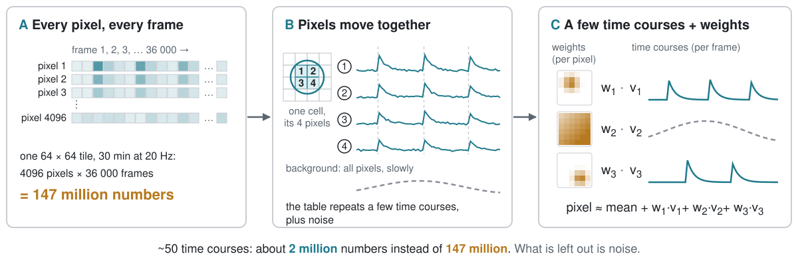
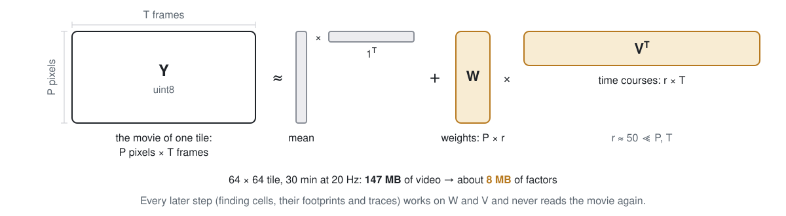
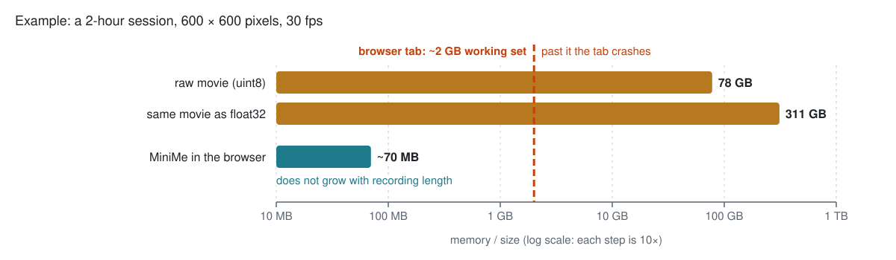

  <picture>
    <source media="(prefers-color-scheme: dark)" srcset="https://raw.githubusercontent.com/MarcelMB/MiniMe/main/docs/assets/minime-logo-dark-1200.png">
    
  </picture>

<h1>
  <picture>
    <source media="(prefers-color-scheme: dark)" srcset="https://raw.githubusercontent.com/MarcelMB/MiniMe/main/docs/assets/minime-heading-dark-1200.png">
    
  </picture>
</h1>

Finds the cells and their calcium traces in one-photon miniscope recordings, inside your
browser. Nothing to install, nothing to upload.

<b><a href="https://marcelbrosch.com/MiniMe/">Open MiniMe →</a></b>

Works in a recent Chrome, Edge, Firefox or Safari. Your videos are read from your own disk
and every step runs on your computer; the page never sends your videos or results anywhere.

## Why it fits in a browser tab

A miniscope movie stores every pixel in every frame, but most of that is repetition: the
pixels of one cell brighten and fade together, and the background drifts across all of them
at once. So a stretch of movie is well described by a few shared time courses plus, for
every pixel, a weight saying how much of each it shows.

  <picture>
    <source media="(prefers-color-scheme: dark)" srcset="docs/assets/readme/factors-dark.svg">
    
  </picture>

MiniMe cuts the movie into 64 × 64 px tiles and compresses each tile into its mean, the
weights `W` and the time courses `V` (a truncated SVD that keeps only the components that
carry signal). Finding cells, their footprints and their traces (CNMF) then works on `W`
and `V` and never reads the movie again.

  <picture>
    <source media="(prefers-color-scheme: dark)" srcset="docs/assets/readme/algebra-dark.svg">
    
  </picture>

That is what makes long recordings fit. A browser tab gets about 2 GB to work with; a
2-hour session is far bigger than that. MiniMe reads the videos in pieces, finds the cells
window by window, joins them, and then streams the whole recording once more for each
cell's full trace, keeping about 70 MB in memory however long the recording is.

  <picture>
    <source media="(prefers-color-scheme: dark)" srcset="docs/assets/readme/budget-dark.svg">
    
  </picture>

## How to use it

You set up the run; the rest is automatic.

| Step | | What happens |
| --- | --- | --- |
| 1. Choose the folder with the raw videos | you | Grayscale `.avi` files whose names start with a number (`0.avi`, `1.avi`, … as the Miniscope DAQ writes them), read as one recording in that order. Set the frame rate if there is no `meta.json` / `metaData.json`. |
| 2. Look at the frames and the preprocessing | you | Drag the circle onto a cell: its size sets the cell diameter and the parameters that follow from it. Check the median filter and background removal (tophat) on a few frames. |
| 3. Name the run and check the parameters | you | Start from the defaults, or from the demo settings for the demo session. |
| 4. Run | automatic | Motion correction, compression into `W` and `V`, finding cells window by window, joining the windows, and the full traces. Each stage shows its progress. |
| 5. Look at the results | you | Overview, motion, compression, seeds, units (footprints) and traces, next to the raw and preprocessed frames. Results are saved to a folder you pick or to the browser's own storage. |

MiniMe gives footprints and fluorescence traces; it does not infer spikes.

## Try the demo

A synthetic one-photon session through a GRIN lens (600 × 600 px, 20 fps), with known ground
truth, is on [UCLA Dataverse](https://dataverse.ucla.edu/dataset.xhtml?persistentId=doi:10.25346/S6WHMSXK)
(CC0). It comes as 36 videos of 50 s; the first six (`0.avi` … `5.avi`, about 2.2 GB) make a
5-minute demo. Put them in one folder, open MiniMe, choose that folder and press
**Use the demo settings**.

A real recording (24 segments, about 8.5 GB, CC0) with its behavior video is on
[UCLA Dataverse](https://dataverse.ucla.edu/dataset.xhtml?persistentId=doi:10.25346/S6SGHPCZ)
as well.

## Python package

MiniMe started as a Python package (`pip install minime-cnmf`), which stays the reference
the browser app is checked against. Its install, command line, parameters and differences
from Minian are in [docs/python.md](docs/python.md).

## License

GPL-3.0-or-later. Parts of the algorithms are ported from
[Minian](https://github.com/denisecailab/minian) (GPL-3.0).
